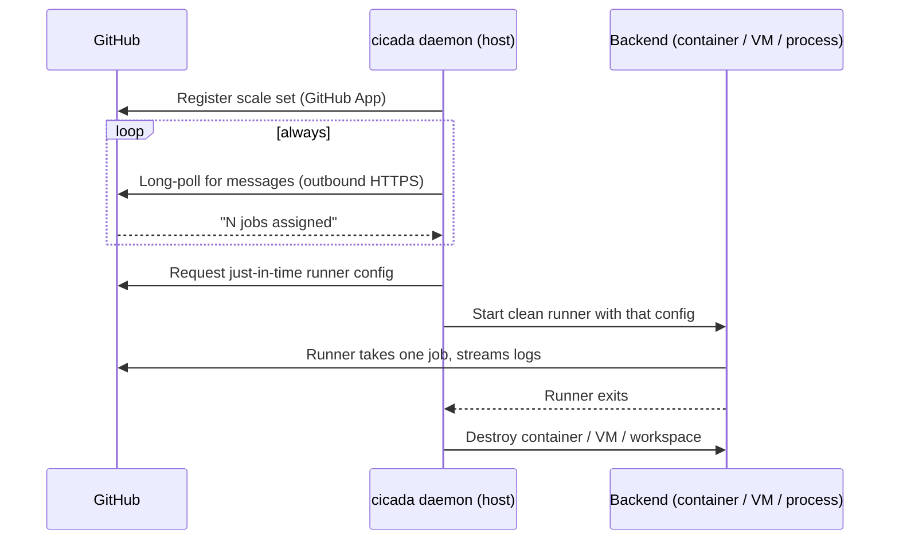

# Cicada: Action Plan

| | |
|---|---|
| Date | 2026-11-21 |
| Status | Approved 2026-11-21. Milestone 0 in progress; see [Spikes](Spikes.md). |
| Language | Go |
| Scope | Design, scenarios, implementation parts, milestones, tests, release |

Cicada makes self-hosted CI/CD simple. It is one Go binary that turns any Linux, macOS
or Windows machine into a pool of clean, single-use GitHub Actions runners for every
repo you choose, with one command and no per-project setup.

Items marked **(to verify)** are assumptions that a spike in Milestone 0 must confirm
before we build on them.

---

## 1. Goals and principles

| Goal | What it means in practice |
|---|---|
| Simple | Install, run `cicada up`, done. No config file needed. No per-repo runner install. |
| Resilient | Survives crashes, reboots and network loss. Cleans up after itself. |
| Scalable | Zero runners when idle, up to the host's capacity under load, more hosts when needed. |
| Modular | Clean architecture. Backends and forges are plug-ins behind small interfaces. |
| Secure | One job per runner, least privilege, no long-lived tokens on runners. |
| Light | One daemon, no database, no central server, no inbound ports. |
| Open | Open source, permissive dependencies only, works for any org or personal account. |

**Not in scope:** our own pipeline language, a hosted service, a web dashboard,
Kubernetes (GitHub's ARC already covers it).

## 2. Decisions

| # | Decision | State |
|---|---|---|
| D1 | Cicada is a runner layer over GitHub Actions, not a new CI engine. | Decided |
| D2 | Written in Go. | Decided |
| D3 | Built on GitHub runner scale sets through `actions/scaleset` (MIT, public preview). | Proposed |
| D4 | Authentication is a GitHub App created by `cicada up`; PAT is a fallback. | Proposed |
| D5 | Each host is autonomous. No central server. | Proposed, depends on spike S2 |
| D6 | Licence: Apache-2.0. | **Open, owner decides** |
| D7 | Ownership: personal project or ThoughtBox project. | **Open, owner decides** |

## 3. Architecture

### 3.1 How a job flows



Only outbound HTTPS is used. Nothing listens on the network.

### 3.2 Layers (clean architecture)

```
cmd/cicada                 CLI entry point and composition root
internal/domain            Pool, Runner, Job, Capacity, Scope, policies. No imports of adapters.
internal/app               Use cases: Onboard, Scale, Reconcile, Drain, Doctor, Update
internal/ports             Interfaces the use cases need (below)
internal/adapters/
    forge/github           Scale sets, JIT config, App auth, repo discovery
    provider/docker        Container per job (Linux)
    provider/process       Clean process per job (macOS, Windows, Linux fallback)
    provider/macvm         VM per job (Apple Virtualization framework)
    secrets/               Keychain (macOS), DPAPI (Windows), 0600 file / libsecret (Linux)
    state/file             Atomic JSON state file
    service/               systemd, launchd, Windows Service
    runnerdist/            Download, verify and cache the GitHub runner binary
    control/               Local socket / named pipe for `cicada status`
internal/platform          Logging (slog), config loading, version stamp
```

### 3.3 Ports

| Port | Responsibility | First adapter |
|---|---|---|
| `Forge` | Register/delete scale sets, receive job messages, issue JIT configs, list repos in scope | GitHub |
| `Provider` | `Prepare`, `Start(jit)`, `Wait`, `Destroy`, `ListOwned`, `Capacity` | Docker |
| `SecretStore` | Store and read the App private key and tokens | OS keychain |
| `StateStore` | Persist scale set IDs and live runner records | JSON file |
| `ServiceManager` | Install, start, stop, remove the daemon as an OS service | systemd |
| `RunnerDist` | Provide a verified runner binary or image of the required version | GitHub releases |
| `Clock` | Time, for testable timeouts and back-off | System clock |

### 3.4 Planned dependencies (all to be licence-checked and pinned when added)

| Need | Candidate | Licence |
|---|---|---|
| Scale set protocol | `github.com/actions/scaleset` | MIT |
| CLI | `github.com/spf13/cobra` | Apache-2.0 |
| Config | `github.com/BurntSushi/toml` | MIT |
| Docker API | `github.com/docker/docker/client` | Apache-2.0 |
| macOS VMs | `github.com/Code-Hex/vz` | MIT |
| OS service | `github.com/kardianos/service` or stdlib + `x/sys` | Zlib / BSD-3 |
| Keychain | `github.com/zalando/go-keyring` | MIT |
| Logging | stdlib `log/slog` | BSD-3 |

Tart is **not** used: its licence carries usage limits and its current terms are unclear.

### 3.5 Files on the host

| OS | Config | State and cache | Logs |
|---|---|---|---|
| Linux | `/etc/cicada/cicada.toml` | `/var/lib/cicada/` | journald |
| macOS | `~/Library/Application Support/cicada/` | same folder | `~/Library/Logs/cicada/` |
| Windows | `%ProgramData%\cicada\` | same folder | Event Log + file |

All files are written atomically with owner-only permissions.

---

## 4. Scenarios

Each scenario has an ID so tests and milestones can point at it. "M" is the milestone
that delivers it.

### 4.1 Onboarding

| ID | Scenario | Expected behaviour | M |
|---|---|---|---|
| ON-01 | First host, one organisation | `cicada up` opens the browser, creates the GitHub App from a manifest, user installs it on the org, Cicada registers one org-level scale set, installs the service, prints the `runs-on` line to use. | 1 |
| ON-02 | Personal account | Same flow. GitHub only allows repo-level runners here, so Cicada registers a scale set for each repo the user selected in the App install screen. **(to verify, S1)** | 2 |
| ON-03 | Several orgs and accounts on one host | `cicada up` again, or `cicada add`, adds another installation. One daemon serves all. | 2 |
| ON-04 | Second host joins | On the new host run `cicada join` with a one-time code shown by `cicada invite` on the first host; the App key is transferred encrypted. No browser steps. | 5 |
| ON-05 | Headless server (no browser) | `cicada up` prints a URL and waits; the user finishes in any browser and pastes back a code. | 2 |
| ON-06 | User cannot create GitHub Apps | `cicada up --pat` reads a token from an environment variable or prompt (never an argument), with a warning about its wider scope. | 2 |
| ON-07 | GitHub Enterprise Server | `cicada up --url https://ghe.example.com`. | 6 |
| ON-08 | New repo created later | Org: works at once. Personal: picked up on the next discovery cycle if inside the App's repo selection. | 2 |
| ON-09 | Repo removed from the App | Its scale set is deleted on the next discovery cycle. | 2 |
| ON-10 | Missing prerequisite (no Docker, old OS) | `cicada up` runs `doctor` first and says exactly what is missing and the command to fix it. Falls back to process mode only if the user agrees. | 1 |
| ON-11 | Existing hand-installed runners | `doctor` lists them and explains they can stay; Cicada never touches runners it did not create. | 2 |

### 4.2 Running jobs

| ID | Scenario | Expected behaviour | M |
|---|---|---|---|
| JOB-01 | Simple job | `runs-on: cicada` starts a clean runner, runs the job, destroys it. | 1 |
| JOB-02 | Pick an OS | Labels `cicada`, `linux` / `macos` / `windows`, `x64` / `arm64` are set from the host. | 1 |
| JOB-03 | Many jobs at once | Starts up to `max_jobs` (default derived from CPU and memory); the rest wait in GitHub's queue. | 1 |
| JOB-04 | Job builds Docker images | A private Docker daemon is started beside the job and destroyed with it. The host socket is never shared by default. | 2 |
| JOB-05 | `container:` and `services:` in the workflow | Work through the same private daemon. | 2 |
| JOB-06 | Job cancelled or timed out | The runner exits; Cicada destroys the backend. A hard time limit destroys runners that outlive `job_timeout`. | 1 |
| JOB-07 | Runner dies before taking the job | Cicada sees the exit while GitHub still reports the job assigned and starts a replacement. | 1 |
| JOB-08 | Resource limits | CPU, memory and disk limits per job from config, with safe defaults. | 2 |
| JOB-09 | Faster starts | Optional warm pool keeps N idle runners ready. Off by default. | 5 |
| JOB-10 | Dependency and image caching | GitHub's own cache works unchanged. Opt-in local read-only caches and an image pull-through cache. | 5 |
| JOB-11 | iOS / Flutter build with signing | macOS process mode under a dedicated user with access to the signing keychain; workspace wiped after each job. | 3 |
| JOB-12 | Clean macOS build | macOS VM cloned from a base image, destroyed after the job. Limit of 2 VMs per host (Apple's licence). | 3 |
| JOB-13 | Windows build | Clean process under a dedicated low-privilege user inside a job object so the whole process tree is killed. | 4 |
| JOB-14 | Custom image or tools | `image = "..."` per pool in config; several pools per host with their own labels. | 2 |

### 4.3 Scale and fleet

| ID | Scenario | Expected behaviour | M |
|---|---|---|---|
| SC-01 | Idle | Zero runners. One daemon, one long-poll per scale set. | 1 |
| SC-02 | Burst above capacity | Excess jobs wait in GitHub's queue; nothing is dropped. | 1 |
| SC-03 | Several hosts share load | Each host registers its own scale set with shared labels; GitHub spreads jobs. **(to verify, S2)**. Fallback: one coordinator host hands jobs to workers. | 5 |
| SC-04 | Personal account with hundreds of repos | Only repos selected in the App install are registered; a cap with a clear warning; polls share one connection pool. | 2 |
| SC-05 | Mixed fleet (Linux + Mac + Windows) | Each host advertises only its own OS labels; jobs route by label. | 4 |
| SC-06 | Host under pressure | Capacity drops when free memory or disk is below a threshold; new jobs wait. | 5 |

### 4.4 Failure and recovery

| ID | Scenario | Expected behaviour | M |
|---|---|---|---|
| FR-01 | Daemon crash or kill | The OS service restarts it. On start it lists every resource it labelled, keeps those with a live job, destroys the rest. | 1 |
| FR-02 | Host reboot | Service starts at boot, same reconcile. Jobs that were running are reported failed by GitHub and can be re-run. | 1 |
| FR-03 | Network loss | Back-off with jitter, session re-created on return. Running jobs are left alone. | 1 |
| FR-04 | GitHub API errors or rate limit | Back-off honouring `Retry-After`; `status` shows "degraded" with the reason. | 1 |
| FR-05 | Docker daemon down | Pool marked unavailable, retried; no crash. | 1 |
| FR-06 | Disk full | Old images, caches and workspaces are pruned by policy; capacity goes to zero until space returns. | 2 |
| FR-07 | Graceful stop or upgrade | `cicada down` or SIGTERM stops taking jobs, waits for running jobs up to `drain_timeout`, then exits. | 1 |
| FR-08 | State file corrupt or lost | Rebuilt from GitHub and from backend labels; a backup of the bad file is kept. | 2 |
| FR-09 | Scale set deleted on GitHub by hand | Re-registered automatically. | 2 |
| FR-10 | App uninstalled or key revoked | Cicada stops polling that installation, reports it clearly, keeps serving others. | 2 |
| FR-11 | Runner version too old for GitHub | The runner binary and image are refreshed automatically before GitHub's cut-off. | 2 |
| FR-12 | Clock skew | App JWT signing fails with a clear `doctor` message rather than a silent retry loop. | 2 |

### 4.5 Security

| ID | Scenario | Control | M |
|---|---|---|---|
| SE-01 | Malicious pull request from a fork | Public repos are refused unless explicitly allowed per repo; docs explain GitHub's "require approval" setting. | 1 |
| SE-02 | Job tries to keep a foothold | Runner, filesystem and network namespace are destroyed after each job. | 1 |
| SE-03 | Job tries to read Cicada's credentials | The App key lives in the OS secret store, outside any job's reach; jobs get only a single-use JIT config. | 1 |
| SE-04 | Job tries to reach the host or LAN | Linux: isolated network, no host socket, non-root, dropped capabilities, no privileged mode. Optional egress allow-list. | 2 |
| SE-05 | Tampered runner download | SHA-256 checked against GitHub's published value over TLS; refused on mismatch. | 1 |
| SE-06 | Tampered Cicada release | Signed binaries, checksums, SBOM and build provenance; `cicada update` verifies before replacing. | 6 |
| SE-07 | Secrets in logs | Tokens and keys are redacted at the logging layer; tested. | 1 |
| SE-08 | Local user talks to the control socket | Socket / pipe is owner-only; read-only commands by default. | 1 |
| SE-09 | Process mode (macOS, Windows) is weaker | Stated plainly in docs and in `cicada up`; recommended only for private repos with trusted contributors. | 3 |
| SE-10 | Over-broad App permissions | Manifest requests only: self-hosted runners (org) or administration (repo), and metadata read. **(exact set to verify, S3)** | 1 |

### 4.6 Day-2 operations

| ID | Scenario | Expected behaviour | M |
|---|---|---|---|
| OP-01 | "Is it working?" | `cicada status`: scale sets, running jobs, capacity, last error. | 1 |
| OP-02 | "Why is it not working?" | `cicada doctor`: checks sign-in, permissions, network, backend, disk, clock, versions; each failure has a fix. | 1 |
| OP-03 | Logs | `cicada logs [-f]`; structured JSON for the daemon. | 1 |
| OP-04 | Upgrade Cicada | `cicada update` verifies, drains, swaps, restarts. Package managers work too. | 6 |
| OP-05 | Change config | Edit `cicada.toml`, `cicada reload`; validated before it is applied, old config kept on error. | 2 |
| OP-06 | Metrics | Opt-in Prometheus endpoint on localhost only. | 5 |
| OP-07 | Remove everything | `cicada down --purge` deletes scale sets on GitHub, runners, images, service and local files, and tells the user how to delete the App. | 2 |
| OP-08 | Rotate the App key | `cicada rotate-key` walks through it without downtime. | 6 |

---

## 5. Implementation parts

| # | Part | Contents | M |
|---|---|---|---|
| P1 | Project base | Go module, layout from 3.2, lint, CI, `version.sh` stamp, README, `documents/`, `CLAUDE.md`, licence. | 0 |
| P2 | Domain | Pool, capacity maths, runner state machine (`pending → starting → idle → busy → done / failed`), scope and policy rules. Pure, fully unit-tested. | 1 |
| P3 | GitHub forge adapter | App auth, scale set create/get/delete, message session, JIT config, back-off, repo discovery. | 1–2 |
| P4 | Scaler and reconciler | Turns "assigned jobs" into desired runners, starts and stops them, reaps orphans, replaces dead runners, drains. | 1 |
| P5 | Docker provider | Container per job, limits, isolated network, private Docker daemon for jobs, image pull and prune. | 1–2 |
| P6 | Onboarding | App manifest flow with a loopback callback, headless mode, PAT fallback, install selection, first registration. | 1–2 |
| P7 | Secrets and state | Secret store per OS, atomic state file, recovery. | 1 |
| P8 | Service management | systemd unit, launchd agent/daemon, Windows Service; install, remove, status. | 1, 3, 4 |
| P9 | CLI and control channel | `up`, `add`, `status`, `doctor`, `logs`, `reload`, `down`, `update`; local socket / named pipe. | 1–2 |
| P10 | Runner distribution | Download, verify, cache and refresh the runner binary and default image. | 1–2 |
| P11 | Process provider | Dedicated user, clean workspace, process-tree kill (process groups on Unix, job objects on Windows). | 3–4 |
| P12 | macOS VM provider | Virtualization framework via `vz`, base image handling, clone per job, signed helper binary with the virtualization entitlement. | 3 |
| P13 | Fleet | `invite` / `join`, shared-label or coordinator mode per S2, capacity-aware behaviour. | 5 |
| P14 | Performance | Warm pool, local caches, image pull-through, start-time measurements. | 5 |
| P15 | Observability | Metrics endpoint, richer `status`, health states. | 5 |
| P16 | Release engineering | Reproducible builds, signing, SBOM, Homebrew, winget, apt/rpm, install script, `update`. | 6 |
| P17 | Docs | Quick start, per-OS guides, security model, config reference, troubleshooting, migration from hand-installed runners. | every M |

## 6. Milestones

Version numbers are proposals; the real ones are set through `/promote`.

| M | Name | Delivers | Exit criteria |
|---|---|---|---|
| 0 | Foundation and spikes | P1, spikes S1–S5, threat model draft | Every **(to verify)** item answered and this plan updated; empty binary builds on all three OSes in CI. |
| 1 | Linux MVP (0.1) | P2–P10 core | On a clean Linux host, `cicada up` to a green job on an org repo in under 5 minutes; ON-01, ON-10, JOB-01–03, 06, 07, SC-01–02, FR-01–05, 07, SE-01–03, 05, 07, 08, 10, OP-01–03 pass. |
| 2 | Complete Linux and accounts (0.2) | Personal accounts, multi-install, Docker-in-job, config, purge | Remaining ON, JOB-04, 05, 08, 14, SC-04, FR-06, 08–12, SE-04, OP-05, 07 pass. |
| 3 | macOS (0.3) | P11 (Unix), P12, launchd | JOB-11, JOB-12, SE-09 pass on Apple Silicon; a real Flutter iOS build goes green. |
| 4 | Windows (0.4) | P11 (Windows), Windows Service | JOB-13, SC-05 pass; a real Windows build goes green. |
| 5 | Fleet and speed (0.5) | P13–P15 | ON-04, SC-03, SC-06, JOB-09, JOB-10, OP-06 pass; measured start time and idle footprint published. |
| 6 | Hardening and 1.0 | P16, external-style security review, GHES | SE-06, OP-04, OP-08, ON-07 pass; vulnerability and licence scans clean; docs complete. |

After Milestone 2 our own repos can move over, so the tool is tested on real work early.

## 7. Spikes (Milestone 0)

| ID | Question | Why it matters | If the answer is "no" |
|---|---|---|---|
| S1 | Can a GitHub App register repo-level scale sets on a personal account, and with which permissions? | ON-02, the "anyone can use it" promise. | Use fine-grained PATs for personal accounts. |
| S2 | When two scale sets share labels, does GitHub spread jobs across them, and what happens when one is full? | SC-03, decision D5. | Coordinator mode: one listener host, workers pull work from it. |
| S3 | Does the App manifest flow accept a loopback callback from a CLI, and what is the smallest permission set? | ON-01, SE-10. | Guided manual App creation with a pre-filled link. |
| S4 | macOS VMs: can `vz` clone and boot a macOS guest fast enough, how do we build and ship base images, and what signing does the helper need? | JOB-12. | Ship macOS with process mode only at first; VM mode later. |
| S5 | Windows: does the runner behave under a low-privilege user in a job object, and is cleanup complete? | JOB-13. | Evaluate Windows containers or Hyper-V earlier. |

Each spike ends with a short note in `documents/` and an update to this plan.

## 8. Testing

| Level | What | How |
|---|---|---|
| Unit | Domain, scaler, reconciler, capacity, policies, redaction | Fake ports and a fake clock; no network. Target 85 % on `domain` and `app`. |
| Contract | Every `Provider` and `Forge` adapter | One shared test suite each adapter must pass. |
| Integration | Docker provider, state, secrets, service install | Real Docker in CI; OS matrix for service and secrets. |
| End to end | Full flow against GitHub | A dedicated test org and test repos; scenario IDs from section 4 map to tests. |
| Chaos | FR scenarios | Kill the daemon, cut the network, fill the disk, stop Docker mid-job. |
| Security | SE scenarios | Hostile workflow suite (escape attempts, credential hunting, fork PR), `govulncheck`, licence scan, secret scan. |
| Soak | Leaks and drift | Thousands of short jobs over a day; watch memory, handles, leftover resources. |

Cicada's own CI runs on GitHub-hosted runners first, then on Cicada itself from Milestone 2.

## 9. Configuration (optional file)

```toml
# Everything here is optional. Defaults are chosen at `cicada up`.
max_jobs      = 4            # default: from CPU and memory
job_timeout   = "6h"
drain_timeout = "30m"
allow_public  = []           # repos allowed to run public-repo jobs

[[pool]]
name   = "default"
labels = ["cicada"]
image  = "ghcr.io/actions/actions-runner:latest"
cpus   = 2
memory = "4g"
docker = "isolated"          # isolated | none | host-socket (unsafe)
warm   = 0
```

## 10. Release and distribution

- Single static binary per OS and architecture; the macOS build also carries the signed VM helper.
- Install: one-line script, Homebrew, winget, apt and rpm packages.
- Every release: checksums, signature, SBOM, provenance, change log.
- SemVer. Config and state formats are versioned and migrated automatically.

## 11. Risks

| Risk | Impact | Mitigation |
|---|---|---|
| `actions/scaleset` is in public preview and may change | Rework of the forge adapter | It sits behind the `Forge` port; pin the version; contract tests catch drift. |
| Shared-label spreading does not work as hoped (S2) | Fleet design changes | Decide in Milestone 0, before any fleet code. |
| macOS VM images are large and slow to build | Milestone 3 slips | Process mode ships first and already covers our iOS builds. |
| Process mode is weaker isolation | Misuse on untrusted code | Refuse public repos in process mode; clear warnings. |
| Windows cleanup is incomplete | Leaks between jobs | Job objects, dedicated user profile reset, soak tests. |
| GitHub forces runner updates | Jobs refused | Automatic refresh (FR-11). |
| Scope creep toward a full CI product | Never ships | The "not in scope" list in section 1. |

## 12. Open questions for the owner

1. Licence (D6) and ownership (D7).
2. Name and email for the personal Gita profile, so the remote can be connected.
3. Which of our repos should be the first real users after Milestone 2?
4. Do we need Intel Macs, or Apple Silicon only?

## 13. Sources

- https://github.com/actions/scaleset
- https://github.blog/changelog/2026-02-05-github-actions-early-february-2026-updates/
- https://github.blog/changelog/2026-03-19-actions-runner-controller-release-0-14-0/
- https://docs.github.com/en/rest/actions/self-hosted-runners
- https://docs.github.com/en/apps/sharing-github-apps/registering-a-github-app-from-a-manifest
- https://github.com/Code-Hex/vz
- https://github.com/cloudbase/garm
- https://github.com/ysya/runscaler
